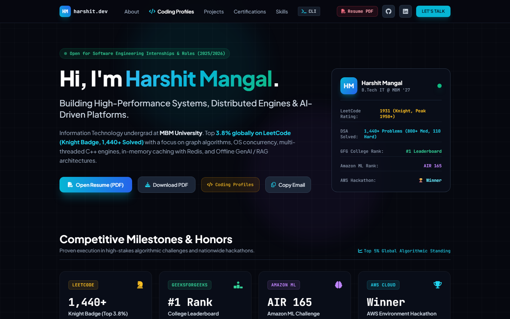

# ⚡ Harshit Mangal — Software Engineer Portfolio

<div align="center">

  [](https://harshitmangal.github.io/portfolio/)
  [-FFA116?style=for-the-badge&logo=leetcode&logoColor=black)](https://leetcode.com/u/Harshit_mangal/)
  [](https://auth.geeksforgeeks.org/user/harshitmangal)
  [](https://linkedin.com/in/harshit-mangal)
  [](https://harshitmangal.github.io/portfolio/Harshit_Mangal_Resume_Latest.pdf)

  <p align="center">
    <strong>Systems & Full-Stack Software Engineer | B.Tech IT @ MBM University ('27)</strong><br>
    <em>Building high-performance distributed systems, AI-driven platforms, and scalable web apps.</em>
  </p>

</div>

---

## 📸 Portfolio Preview

<div align="center">
  <a href="https://harshitmangal.github.io/portfolio/">
    
  </a>
  <p align="center"><em>Click the image above to view the live interactive website.</em></p>
</div>

---

## 🚀 Live Demo & Quick Links

- 🌐 **Live Website:** [harshitmangal.github.io/portfolio](https://harshitmangal.github.io/portfolio/)
- 📄 **Latest Resume:** [Download / View PDF](https://harshitmangal.github.io/portfolio/Harshit_Mangal_Resume_Latest.pdf)
- 💻 **Interactive CLI:** Accessible directly on the live website (press `CLI` in navbar or type `cat resume`, `stats`, `projects`)
- 📧 **Email:** [mangalharsh54@gmail.com](mailto:mangalharsh54@gmail.com)

---

## 🏆 Key Milestones & Badges

| Platform / Award | Achievement | Details |
| :--- | :--- | :--- |
| **LeetCode** | ♞ **Knight Badge** | Rating: **1931** (Peak 1950+), **Top 3.8%** globally, **1,440+** DSA solved |
| **GeeksforGeeks** | 🥇 **College Rank 1** | Ranked **#1** across MBM University with **1,100+** coding problems solved |
| **Amazon ML Challenge** | 🏅 **AIR 165** | All India Rank 165 competing against thousands of engineering teams nationwide |
| **WeMakeDevs & AWS** | 🏆 **Hackathon Winner** | 1st Place Winner at **Environmental Hacks** for cloud-native environmental tracking |

---

## 🛠️ Featured Projects

### 1. 🛒 [ShopSphere](https://flipcart-clone-mu.vercel.app) — AI-Driven B2C E-Commerce Platform
- **Stack:** React, Node.js, Express, MongoDB, Redux Toolkit, Socket.io, Redis, Razorpay, Google Gemini API
- **Features:** Full-stack e-commerce marketplace with real-time socket chat, Gemini AI shopping assistant, Redis sub-2ms caching, and Razorpay checkout.
- **Links:** [Live Demo](https://flipcart-clone-mu.vercel.app) | [GitHub Repository](https://github.com/HarshitMangal/Flipcart-Clone)

### 2. 🤖 [AI Document Assistant](https://github.com/HarshitMangal/AI-Document-Chatbot) — Offline RAG System
- **Stack:** Python, Streamlit, Ollama (LLaMA 3.2), FAISS, SentenceTransformers, PyMuPDF
- **Features:** 100% offline, privacy-first document Q&A assistant using local vector embeddings and local LLM inference without external API reliance.
- **Links:** [GitHub Repository](https://github.com/HarshitMangal/AI-Document-Chatbot)

### 3. 🏡 [Wanderlust](https://major-project-wht3.onrender.com) — Geospatial Rental Booking SaaS
- **Stack:** Node.js, Express, MongoDB, React, Mapbox GL JS, Cloudinary
- **Features:** Full-stack Airbnb clone with interactive Mapbox geospatial discovery, user reviews, and Cloudinary media optimization pipeline.
- **Links:** [Live Demo](https://major-project-wht3.onrender.com) | [GitHub Repository](https://github.com/HarshitMangal/major_project)

### 4. 🗺️ [SmartRoute](https://harshitmangal.github.io/smartroute/) — Interactive Multi-Stop Routing Engine
- **Stack:** Leaflet, OpenRouteService API, Graph Algorithms, HTML5, CSS3, JavaScript
- **Features:** High-performance route optimization engine with turn-by-turn navigation, elevation profiles, and GPX export.
- **Links:** [Live Demo](https://harshitmangal.github.io/smartroute/) | [GitHub Repository](https://github.com/HarshitMangal/smartroute)

---

## 💻 Tech Stack & Skills

- **Languages:** C++, Python, C, Java, JavaScript (ES6+), SQL
- **Frontend:** React, HTML5, CSS3, Tailwind CSS, Redux Toolkit, Streamlit
- **Backend & APIs:** Node.js, Express.js, RESTful APIs, Socket.io, JWT Authentication
- **Databases & Caching:** MongoDB, MySQL, SQLite, Redis
- **DevOps & Tools:** Git, GitHub, Docker (Basics), Postman, Linux, Vercel, Render
- **CS Fundamentals:** Data Structures & Algorithms, Operating Systems, DBMS, OOPs, Computer Networks

---

## 🏃 Run Locally

```bash
# Clone the repository
git clone https://github.com/HarshitMangal/portfolio.git

# Navigate to the folder
cd portfolio

# Open in browser (no build steps required - vanilla + Tailwind CDN)
# On Windows:
start index.html
# Or open with VS Code Live Server
```

---

## 📬 Contact & Connect

- **Portfolio:** [harshitmangal.github.io/portfolio](https://harshitmangal.github.io/portfolio/)
- **LinkedIn:** [linkedin.com/in/harshit-mangal](https://linkedin.com/in/harshit-mangal)
- **GitHub:** [@HarshitMangal](https://github.com/HarshitMangal)
- **LeetCode:** [@Harshit_mangal](https://leetcode.com/u/Harshit_mangal/)
- **Email:** [mangalharsh54@gmail.com](mailto:mangalharsh54@gmail.com)

---

<p align="center">
  Designed & Engineered with 💙 by <strong>Harshit Mangal</strong>
</p>
